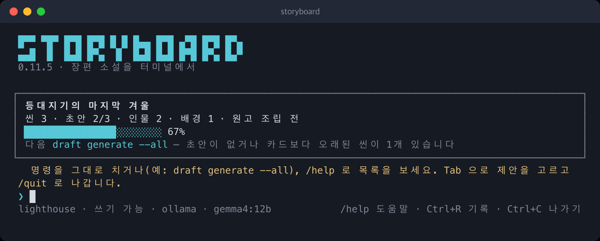
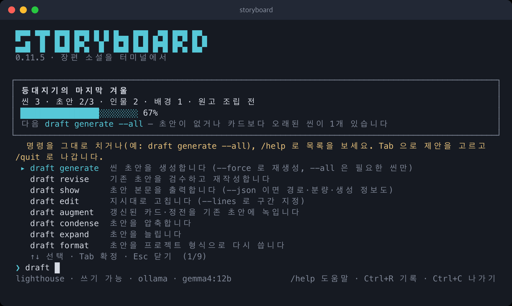
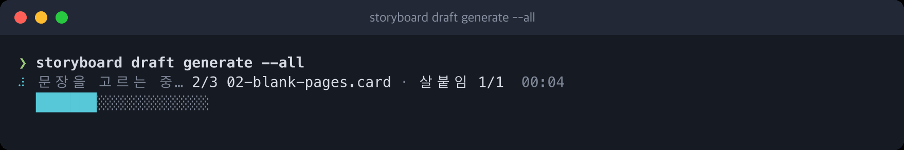

# storyboard (CLI)

Storyboard from a terminal. Same engine as the VSCode extension, no editor required — which is what
lets another AI agent drive a Storyboard workspace.



What each screen looks like — help, `status`, `doctor`, the progress rail, the sentence diff and the
interactive screen — is in the [screen guide](GUIDE.md) (Korean).

## Install

```bash
curl -fsSL https://raw.githubusercontent.com/maroomir/storyboard/main/scripts/install.sh | bash
```

The script resolves the latest release, verifies the checksum, unpacks into
`~/.local/share/storyboard` and links `~/.local/bin/storyboard`. The artifact is a bundled Node
script, so the machine needs **Node 20 or newer**.

From a checkout:

```bash
npm install && npm run cli:build && node apps/cli/dist/index.mjs --help
```

## First run

```bash
storyboard init --title "밤의 항해"   # an empty directory becomes a workspace (and a git repository)
storyboard setup                      # pick the AI provider (and key) — shared with the extension
storyboard project set --genre …      # the contract the outline needs (init takes the same flags)
storyboard doctor                     # what is still missing, with the command that fixes it
storyboard status                     # where the work stands, and the command to run next
```

`init` also writes `AGENTS.md` (and a `CLAUDE.md` that imports it) for coding agents working in the
workspace: draft through `storyboard` verbs instead of writing `draft/*.md` by hand, judge by exit
code, ask before changing the contract, the budget or the model. Existing files are never
overwritten; fill in its last section with the work's own notes.

A work is plain files in the repository: `.storyboard/project.json` (the contract),
`.storyboard/structure.yaml` (threads and the scene order), `.storyboard/outline/`, one bundle
folder per card — `character/<slug>.card/`, `background/<slug>.card/`, `narrator/<slug>.card/`,
`scene/NNN-slug.card/` — each with a `card.yaml` header and a `statements.yaml` of sourced
statements, and `draft/NNN-slug.md`. Bundles change through verbs, not by hand. Everything
generated (usage, runs, the run lock, chapter summaries, studio sessions, draft revisions) lives in
one git-ignored database, `.storyboard/cache/storyboard.db`. 0.16 does not open a 0.15 work: it
reports «0.15 형식» and refuses, and there is no conversion — keep using 0.15.x for that work.

`doctor` looks at the workspace for what an older Storyboard left behind: missing `draft/`/`scene/`, a stale `.gitignore` block, bundles it cannot parse or that share a uuid. It also checks the story-state
ledger (the scene bundles' `state.yaml`) against the current cards and scenes: entries whose
scene has been edited since are reported as stale, and generation drops them from the prompt until
you regenerate that scene. When the edit was one you do not want redrafted — beats added to a card
whose prose still stands — `storyboard state reseal [<scene range>]` records the current cards as the
ledger's basis instead, which is the only way to clear that mark without regenerating. A work that
has drafts but no ledger — written before the ledger existed, or brought in from outside — gets one
from `storyboard state generate [<scene range>]`: one `storyStateUpdate` call per scene with a draft,
in number order, skipping the scenes the ledger already carries (`--force` records the named scenes
again and, like regenerating a draft, marks the entries of later scenes stale). The chapter summaries (in the cache database) are checked the
same way against the drafts they were written from, and `storyboard manuscript summarize` refreshes
the ones that no longer match. `storyboard init --repair` restores the directories, `.gitignore` and any missing agent guide
(`AGENTS.md`, `CLAUDE.md`) of an existing workspace without touching the contract (a plain `init` refuses one), finishes an
interrupted scene renumbering, gives a new uuid to the later of two folders that share one, renumbers
scene folders out of structure order, and seals the ledger of scenes that have none against today's
cards and scenes, so edits made after the repair are what count as stale. `doctor` also counts the scenes without beats (fix: `scene plot --all`), warns when a scene
card's place points at a unit its chapter's outline puts in another building (`3동 704호` against
`7동 704호`), and it warns
when the configured model cannot reach the largest scene target — measured, not guessed, and silent
for combinations that were never measured.

`storyboard --help` prints these steps and the command groups, not every command;
`storyboard help <group>` lists one group (by its id — `start`, `plan`, `scene`, `draft`, `card`,
`notes`, `manuscript`, `sim` — or its Korean name), `storyboard help --all` lists every command, and
`storyboard <command> --help` (or `-h`) shows one command's options and examples. Lines wrap to the
terminal width, and a mistyped verb suggests the closest real ones. `-v` prints the version.

## Commands

Every command on a work is `<noun> <verb> [target] [--options]`, two words. The noun is the kind of
file it touches — `project`, `outline`, `scene`, `draft`, `card`, `notes`,
`manuscript` — always singular, and the verb comes from one small vocabulary: `list` and `show` to
look, `create` / `rename` / `move` / `remove` / `set` to change, `generate` / `revise` / `check` and
the like for AI work, `apply` / `discard` for proposals. A kind is an argument, never part of the
name: `card create character`, `card create narrator`, `draft check slop 001-intro`,
`notes connect notion`. The old `narrator` noun is gone; narrators are cards. One-word commands
(`init`, `setup`, `doctor`, `status`, `help`, `tui`, `completion`) are about the machine or the
session rather than a file of the work.

`scene` is the scene card and `draft` is the prose written from it: `scene list|show|create|rename|
move|remove|seed|plot|complete` against `draft generate|revise|show|edit|augment|condense|expand|format|
check`. `storyboard --help` groups the commands the same way: 시작하기, 기획, 씬, 초안, 카드,
노트, 원고, 측정.

```bash
storyboard status                 # contract, outline, cards, scenes, drafts, manuscript + next command
storyboard project show           # the contract, and which fields are still empty
storyboard scene list             # number · thread · title · state (초안 없음 / 초안 / 낡음); the thread column only when there are two
storyboard scene create "옥상에서 둘이 처음 마주친다" --name rooftop --after 2   # the studio fills it; --after inserts and renumbers
storyboard scene move rooftop --after 5   # folders and drafts behind it are renumbered (001-…, 002-…)
storyboard scene remove 003-detour  # the bundle, its draft and revisions; the scenes behind close the gap
storyboard draft show 001-intro   # the draft's body on stdout
storyboard card list character    # cards of one kind (leave the kind out for both)
storyboard card show hana         # one card by slug: its header and numbered statements (--sources: each line's origin, --history: its sessions)
storyboard card interview hana    # ask the writer how 하나 acts in the next scenes (terminal, tui, or --step --json)
storyboard card create character "무뚝뚝한 열일곱 살 궁수 하나" --id hana   # a filled bundle; --dry-run only shows the lines
storyboard card set hana traits "몰리면 먼저 웃는다"   # one line in statements.yaml, the writer's own
storyboard card edit hana "말투를 더 퉁명스럽게"        # the studio's edit; --propose leaves a proposal and a diff
storyboard card apply hana        # take what waits in hana's sessions (card discard drops it)
storyboard card remove sera       # shows what refers to sera; --force cleans it up and removes the bundle
```

A line written by `card set` is the writer's (`author`) and the studio never overwrites it; when
no person can answer (an agent's run) the same verb writes an `agent` line instead. `card unset`
removes lines by facet (and `--key`, `--about`, or the value).

`status --json` carries the same counts plus `data.next` (`step`, `command`, `reason`), so an agent
can ask what to run next and branch on it.

## Tab completion

`install.sh` registers completion for the shell it runs in (zsh, bash or fish) by appending one
line to your rc file, guarded by a `# storyboard completion` marker. To do it by hand:

```bash
eval "$(storyboard completion zsh)"      # ~/.zshrc
eval "$(storyboard completion bash)"     # ~/.bashrc
storyboard completion fish | source      # ~/.config/fish/conf.d/storyboard.fish
```

Tab then completes verbs (with a one-line description in zsh and fish), the flags each verb takes,
provider and model ids, config keys, and the scene stems and card ids in the current workspace (or
the one named by `--workspace`). The shell asks the hidden `storyboard __complete <words…>` verb,
which reads the same command catalog the help does.

## Interactive screen

`storyboard` with no arguments at a terminal opens an Ink-based screen: a header with the
workspace and the AI provider in effect, a log where results and progress lines land, and a prompt
that accepts the same verbs as the one-shot CLI. Typing shows matching verbs (Tab completes, ↑/↓
picks, Esc clears), `/help` lists everything, `/doctor` and `/setup <id>` run those verbs, `/quit`
or Ctrl+C leaves. `storyboard tui` opens it explicitly; in a pipe it refuses and points back to the
one-shot form, so agents never end up inside it.

With no suggestion open, Tab switches the prompt between `storyboard>` and `studio>`. In the
chat mode a plain line goes to the studio: point at a card with `@elia` and say what to change
(`@elia 말투를 더 퉁명스럽게`); the studio leaves a proposal and its diff, `/apply` writes it and
`/discard` drops it. A line starting with `/` runs a verb as in the command mode
(`/card show elia --sources`), and completion follows the prefix — card slugs after `@`, the
shell's list after `/`.



A long run draws a progress rail in place, and one Ctrl+C stops it at the next scene boundary:



More screens: [GUIDE.md](GUIDE.md).

## Use

```bash
storyboard init --title "시그널" --genre "하이틴 로맨스" --audience "10~20대" \
  --pov third-limited --target-words 480000 --chapters 8 --scenes-per-chapter 4
storyboard outline generate        # also writes the cards of the characters the plan names
storyboard scene seed
storyboard scene plot 001-scene-1-1 --dry-run
storyboard draft generate 001-scene-1-1 --force
storyboard draft generate --all
storyboard draft revise 001-scene-1-1
storyboard novel generate
storyboard manuscript assemble && storyboard manuscript review
```

`novel generate` is unattended: every approval gate is passed automatically, and a run the extension
started in an approval mode is continued the same way. At a terminal it asks
whether to continue an interrupted run or start over; in a pipe or with `--json` it continues.

`outline generate` refuses until the contract names a genre, an audience, a point of view and a
target word count, so `init` takes them as flags. `--from <json>` reads the same fields from a file
(a whole `project.json` works too), and flags win over the file. To change the contract later, use
the same inputs on `project set` — keys you leave out keep their current value:

```bash
storyboard project set --target-words 320000 --from contract.json
```

### 인물·배경 인터뷰

`card interview <id>` asks the writer, one situation at a time, how a character (or a place) acts in
the scenes that have no draft yet. Each question comes from a beat of an upcoming scene; the three
options are what that character would plausibly do, each standing for a different value of an axis
the work's genre and contract defined once (for a romance: how affection shows, how distance is
kept; for a thriller: what the character does under pressure, how they lie). Picking one is a vote;
writing your own answer counts double and can become a new value. A character session opens by asking,
for each relation present in those scenes, what the character calls them and how they speak to them;
that answer goes to the card's `relations[].speech` as it is. When one value of an axis reaches
the threshold, the session's end distils it into a proposal for the card — a conditional tendency
such as "몰릴 때 먼저 참고, 밀리면 되묻는다" — that waits in the card's session until `card apply`
writes it to `statements.yaml` (or `card discard` drops it), next to what notes left. The chosen lines themselves never reach a prompt: the choice records, the axis
vocabulary and the working model stay in the interview sessions of the cache database
(`.storyboard/cache/storyboard.db`), and only what is
distilled goes to the card.

A background is interviewed through the same verb (`card interview tavern`): the writer then plays
the place — where someone slips out, who notices, what carries from the kitchen — and the answers
distil into its `layout` and `rules`. `--scenes 3..5` narrows the questions to those scenes,
`--limit 5` ends the session after five answers, and `--reset-axes` throws away the axis vocabulary
(and every card's votes) when the contract has changed. `status` names the cards whose upcoming
scenes still have unanswered axes; `doctor` repeats it and warns when the contract moved under the
vocabulary. The verb asks at a terminal (or in the tui); the lock is not taken, so an interview can
run while a generation is going.

An agent that works with the writer runs the same interview one step per call and shows each
question to the writer itself:

```bash
storyboard card interview hana --step --json                 # opens a session: data.state "question"
storyboard card interview hana --step --json --answer 2      # the option the writer picked
storyboard card interview hana --step --json --write "웃어 버린다"   # or what the writer wrote
storyboard card interview hana --step --json --confirm 1     # after a written answer: 1 keeps the reading
storyboard card interview hana --step --json --finish        # distil; then storyboard card apply hana
```

Every call prints `data.state` — `question` (`question.options` numbered from 1, `allowsText`),
`confirm` (`options`, or `--rename "<name>"` for a new value), `finished` or `abandoned` — and the
open session is continued without `--session`. `--skip` passes over a question, `--abandon` closes
the session without distilling, and `--limit`/`--scenes` go with every call. The answers must be the
writer's own choices: an agent passes only the number the writer picked or the words they wrote.

### 시점과 구성

`--pov` 는 `first`, `first-retrospective`, `second`, `third-limited`, `third-omniscient` 다섯 가운데
하나이고, 그 값 하나가 작품 전체의 서술 인칭과 지식 경계를 정한다. 씬마다 시점을 달리하려면
서술자에 이름을 붙인다:

```bash
storyboard card create narrator hana-first --person first --focal hana --voice "건조한 단문"
storyboard card list narrator
```

씬의 서술자는 `.storyboard/structure.yaml` 의 씬 항목(`narrator`)에 있어서 그 씬만 그 시점으로
생성된다. 장 단위로 바꾸려면 `.storyboard/outline/chapters.yaml` 의 장에 `narrator:` 를 적는다.
씬의 값이 장의 값을 이긴다.

구성은 프리셋으로 고른다. 프리셋이 연속성 줄기(`threads`)와 서술자 카드를 대신 만든다:

```bash
storyboard init --title "네 개의 밤" --composition omnibus --episodes 4
storyboard project set --composition alternating-pov --pov-characters hana,jun --pov first
```

- `linear` — 지금까지의 동작. 줄기 하나.
- `omnibus` — 편마다 독립된 사건과 결말. 이야기 상태·장 요약·직전 씬 맥락이 편 안에서만 이어지고,
  카드의 사실(`fact` 진술)만 공유한다.
- `alternating-pov` — 인물마다 서술자 카드를 만들고 장마다 번갈아 배정한다.
- `frame` — 외화가 내화를 감싸고, 외화는 첫 장과 마지막 장에 놓인다.

씬 하나가 어떤 시점으로 생성될지는 `scene show` 가 해석된 결과로 보여 주고, 끊긴 서술자 참조나
작품 계약에 없는 줄기는 `doctor` 가 미리 잡는다:

```bash
storyboard scene show 003-night-market
```

A scene is a folder, `scene/NNN-slug.card/`, and its draft is `draft/NNN-slug.md`. The three-digit
number is not typed by hand: it comes from the scene's place in `.storyboard/structure.yaml`. Every
verb that takes a scene accepts `003-night-market`, `3` or `night-market`. `scene rename <scene> --to <slug>` takes the scene the same way and a bare slug for the new name
(the engine keeps the number); it moves the bundle and the draft along, and a different number is
refused. To reorder,
use `scene create --after`, `scene move` and `scene remove`, which renumber the folders and drafts
behind them.
If a renumbering is cut off partway, `doctor` reports it, and the next scene-writing verb (or
`init --repair`) finishes it.

```bash
storyboard scene rename night-market --to moon-market   # or: scene rename 3 --to moon-market
```

Notes kept in Obsidian or Notion come in with `notes absorb`. It reads a vault folder (or one note)
or a Notion page with everything under it, plus the notes they link to one step away, and sorts
them into character and background cards, scene cards and a synopsis. It shows the cost estimate
first and asks before writing; an agent passes `--yes`, and `--dry-run` stops at the plan. Cards
that already exist are never overwritten — what the notes add to them waits in the card's session
for `card apply`, and absorbing more notes adds to what is waiting rather than replacing it. Where
two notes give one slot different values, the note absorbed last wins when the proposals are applied;
`card discard <slug>` drops a card's waiting proposals. A synopsis the notes give a work that
already has one waits too: `outline show --pending` shows it, `outline apply` writes it and
`outline discard` drops it, and `status` names whatever is waiting.
The other direction is `notes export
<folder>`: cards, scenes and the synopsis as a Markdown folder (`인물/`, `배경/`, `씬/`,
`시놉시스.md`) with front matter ids and `[[wiki links]]`, for Obsidian or a Notion Markdown import;
no AI is involved, and absorbing the folder again maps back to the same cards.
A Notion page needs an integration token once (`notes connect notion`) and the page shared with
that integration. Without a token, export the page from Notion as «Markdown & CSV» and hand the
zip to the same verb: page and folder names lose their trailing ids, sub-pages keep their tree, and
a database CSV becomes one note unless its rows are pages of their own. A new work can start from
notes in one step:

```bash
storyboard init --title "달의 문" --from-notes ~/Vault/달의문
storyboard notes absorb https://www.notion.so/team/Moon-Gate-1429989fe8ac4effbc8f57f56486db54 --yes
storyboard notes absorb ~/Downloads/Export-달의문.zip --yes
```

`card build` reads the scenes and writes the cards they imply; with `--propose`, changes to cards
that already exist wait as proposals for `card apply`. `scene complete` writes its proposal too.
Pass `--dry-run` to see the proposal without touching the tree. A new card whose name yields no
ascii id is reported rather than filed under a guessed id — create it with
`card create background "학교 3층 끝의 방송실" --name "방송실" --id broadcast-room` and run `card build` again.

Progress lines go to stderr whenever stderr is a terminal (`--quiet` hides them, `--verbose`
forces them for pipes). Color appears only at a terminal; pipes, `--json`, `NO_COLOR` and
`TERM=dumb` stay plain, and `--no-color` turns it off. Setup failures name the fix: no workspace → `storyboard init`, no provider
→ `storyboard setup`, no key → `storyboard apikey set` (asks for the provider, hides the key as you paste it, and checks the connection; `apikey show` lists which providers have a key).

A draft is only as long as the events its scene card carries, so `draft generate` first expands
the card's `beats` when it has none — from the structured fields, the grounding facts and the
summary in the bundle's `summary.md` (staying inside that summary when there is one) — and writes
them to the card before drafting. `scene plot <stem> | --all` runs that step on its own so you can
read the beats before spending a generation: `--dry-run` only prints the proposal, `--all` picks the
scenes without beats, and existing beats are regenerated only with `--force`. The count is
`max(generation.beats.minimum, ceil(targetWordCount / generation.beats.charsPerBeat))` (defaults 5 and 1,500);
`generation.beats.auto: false` turns the automatic step off. Each proposed beat carries its
coordinates — who is present (`cast`, written as card ids), `place` and `time` — so the skeleton
keeps the right people in the right place and the pipeline can decide the scene breaks (`---`)
from them; a name the model uses that matches no card stays as written and `doctor` reports it.

`draft generate` prints the draft's warnings (a short draft, for instance) on stderr and, under
`--json`, in `data.warnings`; the exit code stays 0. `--verbose` also logs each pipeline stage as it
runs, which is how you tell a 20-minute scene apart from a hung one.

`--workspace <path>` picks the workspace (default: the current directory). `--json` puts a single
JSON object on stdout — for failures too (`{"ok":false,"message":…}`), so an agent never has to
parse loose text; progress and warnings always go to stderr. Exit code is 0 on success and non-zero
on failure.

```bash
storyboard draft show 001-scene-1-1 --json | jq -r .data.path
```

## Config

`~/.storyboard/config.json`, shared with the extension, overridden per workspace by
`.storyboard/config.json`. Keys are the extension's setting names without the `storyboard.` prefix.
`storyboard config show` prints the effective values with their origin (공통 / 이 작품 / 기본값) and
`storyboard config set <key> <value>` edits them with the same validation the settings panel uses.
`storyboard params show` goes wider: every value an author can move — the settings, the generation
knobs (a measured model profile over the pipeline default) and each prompt's temperature and output
limit — with where its current value comes from, plus the author resource files in force
(`prompts/<key>.md`, `craftContract.json`, `promptVariants.json`, `compositionPresets.json`,
`pipelines/scene.yaml`, `pipelines/novel.yaml` under `~/.storyboard/` or the workspace's
`.storyboard/`). `storyboard doctor` fails on a resource file it cannot use and says why.

Writes follow git's rule: run inside a workspace and the value lands in that workspace's
`.storyboard/config.json`; add `--global` to write `~/.storyboard/config.json` instead. Outside a
workspace, `config set` and `setup` refuse rather than guess — pass `--global` (or `--workspace`).
Because the workspace layer wins the merge, a `--global` write that the current workspace overrides
says so instead of looking like it did nothing. API keys ignore all of this: they only ever live in
the one 0600 home file.

```json
{ "ai.provider.default": "claude", "tasks": { "sceneDraft": { "provider": "claude", "model": "claude-sonnet-5" } } }
```

A task can run on its own provider and model (`tasks.<task>.provider|model`, task names from
`config set`'s error message or shell completion). Give both at once with `--model`, which
`ai.provider.default` takes too; a lone model takes the default provider with it, and a provider
change drops a model the new provider does not have. `config show` lists only the routed tasks.
`storyboard config unset <key>` removes a key from the file this run writes to — the whole route for
`tasks.<task>.provider` — and says so when the other file still holds a value.

```bash
storyboard config set tasks.noteExtraction.provider claude --model claude-opus-5-5 --global
storyboard config unset tasks.noteExtraction.provider --global
```

Two tasks decide most of what a draft reads like: `sceneSkeleton` lays out the scene and writes
every line of dialogue, and `sceneSectionExpansion` writes the prose around them. Both keep
length and voice better on a top-tier model, so when the default provider runs a mid-size model,
route those two up and leave the cheap tasks (grounding, beats, state updates) where they are:

```bash
storyboard config set tasks.sceneSkeleton.model claude-opus-5-5
storyboard config set tasks.sceneSectionExpansion.model claude-opus-5-5
```

The skeleton can also be acted instead of drafted: put `actBeats` in place of `draftSkeleton` in
`.storyboard/pipelines/scene.yaml` and each beat is played by its cast (one proposal call per
character), merged by an arbiter and scored by a character judge. It reads better on dialogue-heavy
scenes and costs several times the calls, so route its three tasks like the skeleton:

```yaml
version: 1
stages: [buildPersonas, describeBackground, checkBackgroundFacts, collectVoiceSamples, actBeats, polishDialogue, expandSection, attributeDialogue]
```

```bash
storyboard config set tasks.sceneBeatArbiter.model claude-opus-5-5
```

Every provider Storyboard speaks to is reached with an API key (or runs locally, for `ollama`).
Subscription CLI providers were removed in 0.9.2: Anthropic, OpenAI and Google all limit a
subscription or account login to interactive personal use and direct programmatic and bulk
workflows to API keys, which is exactly what this app is for. A config file that still names
`claude-code`, `codex` or `gemini-cli` names nothing: the provider reads as unchosen and generation
refuses until you pick one, because the metered replacement bills at a different rate.

API keys live in `~/.storyboard/secrets.json` at mode 0600, shared by both apps. `STORYBOARD_HOME`
moves the whole directory. The pre-0.8 `cli.json` / `cli-secrets.json` are no longer read: rename
them to `config.json` / `secrets.json`, or run `storyboard setup` again.

## Generated text and provider policies

- **Check what the AI asserts.** Drafts, revisions, review notes and card suggestions are
  model output. Treat any factual claim in them (history, geography, medicine, law, real people or
  places) as unverified until you have checked it yourself. If you hand this app to other writers,
  pass this notice on to them.
- **The provider's usage policy applies to the manuscript.** `openai`, `claude`, `google` and `grok`
  each apply their own content rules to what you generate (for example sexually explicit scenes,
  sexual content involving minors, or material that promotes violence). A request that crosses the
  line is refused by the provider, and repeated violations can restrict the API key or the account.
  `ollama` runs on your machine and no such policy applies.

## What this app does not do

- **It does not commit.** Files are written; git is yours. `init` does run `git init` (after writing
  the ignore block) so a new workspace starts tracked, but the first commit is yours too.
- **It has no editor chrome.** Inline completion, hover, the `.card` custom editor and the relation
  graph have no terminal form. The capabilities behind the diagnostics providers do, and become
  `check` verbs.

Verb coverage against the extension's command palette is enforced by `test/parity.test.ts`: a
command added to the extension without a CLI verb fails the build.
