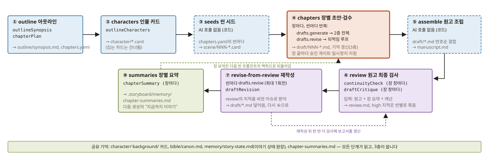
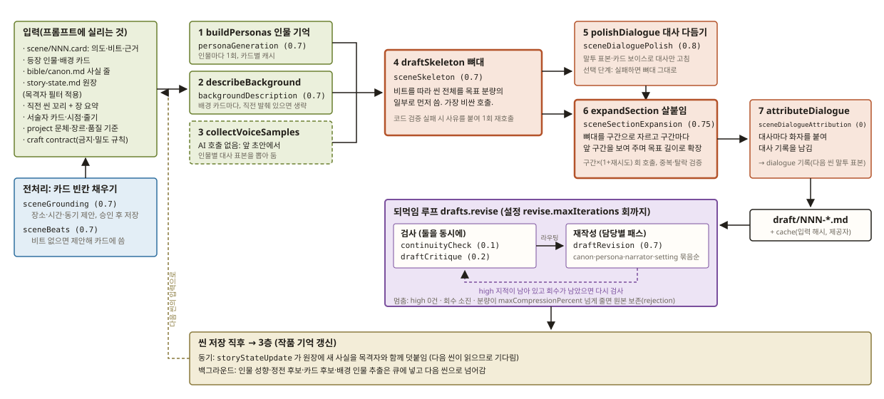
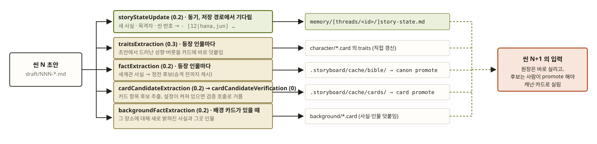

# 역할 프롬프트가 한 편의 작품을 완성하는 길

`packages/story-ai/src/ai/prompts/resources/`의 역할 프롬프트 37개가 어느 순서로 불리고, 무엇을
읽고, 무엇을 파일로 남겨 다음 역할에 넘기는지를 정리한 문서다. 2026-10-08, v0.12.3 `main`의
코드를 직접 따라가며 그렸다. 스테이지 카탈로그(`sceneStageCatalog`, `novelStageCatalog`), 되먹임
루프(`reviseLoop.ts`), 사후 갱신기(`PostGenerationUpdateManager`)의 실제 호출 관계를 반영한다.

한 줄로 요약하면 **"역할 프롬프트를 가진 다단계 파이프라인"이지 "자율 에이전트들의 협업"은
아니다.** 오케스트레이션은 LLM이 아니라 결정적인 코드이고, 역할 사이의 통신 수단은 파일이다.

| 색 | 뜻 |
|---|---|
| 파랑 | 기획: 시놉시스·장 계획·카드 빈칸 |
| 올리브 | 기억·맥락: 페르소나·배경·요약·원장 |
| 벽돌 | 집필: 뼈대·다듬기·살붙임·화자 |
| 보라 | 검수·수정: 연속성 검사·비평·재작성 |
| 황토 | 사후 갱신: 씬이 끝난 뒤 백그라운드 추출 |

점선 네모는 AI 호출이 없는 순수 코드 단계다. 괄호의 숫자는 리소스 파일 front-matter의
`temperature`다.

## 1층. 소설 파이프라인: `novel generate` 한 번이 도는 길

러너(`novelPipeline.ts`)가 `novelStageCatalog`의 8개 스테이지를 순서대로 돈다. 작가의
`pipelines/novel.yaml`이 있으면 그 순서가 카탈로그 위에 덮이되, `required` 스테이지는 뺄 수 없다.

| # | 스테이지 | 부르는 프롬프트 | 읽는 것 | 남기는 것 |
|---|---|---|---|---|
| ① | `outline` 아웃라인 | `outlineSynopsis` → `chapterPlan` | 프로젝트 계약(장르·톤·시놉시스 씨앗·장 수), 인물 요약 | `outline/synopsis.md`, `outline/chapters.yaml` |
| ② | `characters` 인물 카드 | `outlineCharacters` | 계약 + 시놉시스 + 출연진 | `character/*.card` (이미 있는 카드는 건너뜀) |
| ③ | `seeds` 씬 시드 | 없음 (코드) | `chapters.yaml`의 씬 목록 | `scene/NNN-*.card` (있는 카드는 건너뜀) |
| ④ | `chapters` 장별 초안·검수 | 2층 전체 + 되먹임 루프 | 씬 카드 하나씩 | `draft/NNN-*.md`, 3층의 기억 갱신, 검수 기록 |
| ⑤ | `assemble` 원고 조립 | 없음 (코드) | `draft/*.md` 번호순 | `manuscript.md` |
| ⑥ | `review` 원고 최종 검사 | `continuityCheck`, `draftCritique` (장 창마다) | 조립 원고 + 장 요약 + 캐넌 | `review.md`, high 지적을 씬별로 묶은 목록 |
| ⑦ | `revise-from-review` 재작성 | `draftRevision` (되먹임 루프 1회전) | ⑥의 지적을 씨앗 이슈로 | 해당 씬의 `draft/*.md` 덮어씀, 그 뒤 ⑥을 한 번 더 |
| ⑧ | `summaries` 장별 요약 | `chapterSummary` (장마다) | 장의 씬 초안들 | `.storyboard/memory/chapter-summaries.md` |

알아 둘 점:

- **① outline의 재실행**은 이미 만든 장 계획을 그대로 둔다. 새 계획을 만들면 같은 씬이 다른
  이름으로 다시 심어지기 때문이다. 계약의 장 수와 계획의 장 수가 다르면 거부한다.
- **④ chapters**가 전체 비용의 거의 전부다. 장이 끝날 때마다 승인 게이트와 일시정지 지점이
  있고, Ctrl+C는 씬 경계에서 멈춘다. 이어서 실행한 런은 모든 게이트를 자동 승인한다.
- **⑥ review**는 씬 단위가 아니라 **장 단위 창**으로 원고를 다시 읽는다. 그래서 씬 안의
  되먹임 루프가 놓친, 씬과 씬 사이의 모순을 잡는 자리다.
- **⑧ summaries**의 산출물은 다음 생성의 "지금까지 이야기"로 2층 입력에 되돌아간다. 장 요약은
  8000자 예산 안에서 앞 장부터 압축된다.

## 2층. 씬 파이프라인: 씬 카드 한 장이 초안 한 편이 되는 길

1층의 ④가 씬마다 이 길을 한 번 돈다. `drafts.generate`가 `SceneGenerationPipeline`을, 그 뒤
`drafts.revise`가 `runReviseLoop`를 부른다.

### 입력: 프롬프트에 실리는 것

`sceneGenerationInputs.ts`와 `story-model`의 `sceneContext.ts`가 모은다.

- `scene/NNN.card`: 의도, 비트, 근거(장소·시간·동기), 등장 인물·배경 id
- 등장 인물·배경 카드 전문
- `bible/canon.md`의 사실 줄
- `memory/story-state.md` 이야기 상태 원장. `witnessed` 서술자의 초점 인물이 항목의 목격자에
  없으면 그 항목은 빠진다(지식 경계).
- 직전 씬의 꼬리(같은 줄기의 직전 씬) + 장 요약
- 서술자 카드·시점·줄기(씬 카드 > `chapters.yaml`의 장 > 프로젝트 기본)
- 프로젝트 계약의 문체 제약·장르·품질 기준
- craft contract(텔링 금지, 모티프 반복 한도, 상투적 몸짓 금지 목록, 밀도 규칙)

### 전처리: 카드의 빈칸 채우기

두 프롬프트가 7단계보다 먼저, 씬 카드 자체를 고친다. 카드에 이미 값이 있으면 부르지 않는다.

| 프롬프트 | 하는 일 |
|---|---|
| `sceneGrounding` (0.7) | 비어 있는 장소·시간·동기를 제안한다. 사람이 승인하면 카드에 저장하고, 승인 없이 쓴 값은 gap 기록으로 남긴다. |
| `sceneBeats` (0.7) | 비트가 없으면 제안해 카드에 쓴다. |

### 7단계

| # | 스테이지 | 프롬프트 | 하는 일 |
|---|---|---|---|
| 1 | `buildPersonas` 인물 기억 | `personaGeneration` (0.7) | 등장 인물마다 그 인물의 1인칭 기억·태도를 만든다. 카드별로 캐시되어 다음 씬은 다시 부르지 않는다. 줄기가 있으면 줄기별 캐시다. |
| 2 | `describeBackground` 배경 묘사 | `backgroundDescription` (0.7) | 배경 카드마다 분위기 묘사를 만든다. 직전 초안에 그 배경의 발췌가 있으면 그것을 쓰고 호출을 생략한다. |
| 3 | `collectVoiceSamples` 말투 표본 | 없음 (코드) | 앞 초안들의 화자 기록에서 인물별 대사 표본을 뽑아 둔다. |
| 4 | `draftSkeleton` 뼈대 | `sceneSkeleton` (0.7) | 입력 전부 + 1·2·3의 산출물을 받아 비트를 따라 씬 전체를 목표 분량의 일부(뼈대 비율)로 먼저 쓴다. 가장 비싼 호출이라 코드 검증에 실패해도 **한 번만** 사유를 붙여 다시 부르고, 둘 다 위반이면 가벼운 쪽을 남긴다. |
| 5 | `polishDialogue` 대사 다듬기 | `sceneDialoguePolish` (0.8) | 말투 표본과 카드 보이스로 대사만 손본다. 선택 단계이고, 실패하면 뼈대를 그대로 쓴다. |
| 6 | `expandSection` 살붙임 | `sceneSectionExpansion` (0.75) | 뼈대를 구간으로 자르고, 구간마다 앞 구간을 보여 주며 목표 길이로 확장한다. 구간×(1+재시도) 회 호출하고, 겹침·탈락·반복을 코드로 검증한다. |
| 7 | `attributeDialogue` 화자 붙이기 | `sceneDialogueAttribution` (0) | 완성 초안의 대사마다 화자를 붙여 대사 기록을 남긴다. 이 기록이 다음 씬의 3단계 말투 표본이 된다. |

산출물은 `draft/NNN-*.md`와 입력 해시·제공자를 적은 캐시다. 같은 입력이면 캐시 적중으로 다시
생성하지 않는다.

**왜 뼈대와 살붙임이 나뉘어 있나.** 한 번의 호출로 긴 씬을 쓰면 뒤로 갈수록 비트가 뭉개지고
분량이 모자란다. 그래서 전체 구조를 먼저 짧게 잡아 두고(뼈대), 구간마다 앞 구간을 보여 주며
분량을 채운다(살붙임). 실측에서 분량의 병목은 살붙임 한 구간의 출력 상한이었고, 비트 수를
늘려도 분량은 늘지 않았다.

### 되먹임 루프 `drafts.revise`

생성이 아니라 그 뒤의 별도 루프다. `revise.maxIterations` 회까지 돈다.

1. **검사**: `continuityCheck` (0.1)와 `draftCritique` (0.2)를 **동시에** 부른다. 연속성 검사는
   캐넌·원장의 사실 줄과 본문을 맞추고, 비평은 voice / purpose / repetition 세 관점만 본다.
   첫 회전에는 1층 ⑥이 넘긴 씨앗 이슈도 합친다.
2. **라우팅**: 지적마다 담당을 정한다. `reviewRouting.ts`의 네 담당 `canon` / `persona` /
   `narrator` / `setting`과 카드 id로 묶고, 어디에도 속하지 않으면 전역 지시로 둔다.
3. **재작성**: 담당 묶음마다 `draftRevision` (0.7)을 한 번씩 부른다(패스). 한 호출에 모든 지적을
   넣지 않는 이유는 한 번에 고치면 서로 다른 성격의 지적이 섞여 본문이 평평해지기 때문이다.
4. **멈춤 조건**: high 지적이 0건이거나, 회수를 다 썼거나, 취소됐을 때. 재작성으로 분량이
   `revise.length.maxCompressionPercent`보다 많이 줄면 원본을 보존하고 거부(rejection) 기록을
   남긴다.

### 씬 저장 직후

`storyStateUpdate` (0.2)만 **동기**로 돈다. 다음 씬이 원장을 읽으므로 백그라운드 큐가 아니라
저장 경로에서 기다린다. 나머지 추출기는 큐에 넣고 다음 씬으로 넘어간다(3층).

## 3층. 작품 기억: 씬이 끝날 때마다 다음 씬이 읽을 것을 갱신하는 길

"협업"에 가장 가까운 부분이다. 역할들끼리 직접 대화하지는 않지만, 파일을 통해 다음 역할에 말을
건다. 씬 N의 생성이 끝나면 다섯 추출기가 돌고, 그 결과는 씬 N+1의 프롬프트에 실린다.

| 추출기 | 호출 | 읽는 것 → 쓰는 곳 | 다음 씬에 실리는 때 |
|---|---|---|---|
| `storyStateUpdate` (0.2) | 동기, 씬마다 1회 | 초안 + 이전 원장 → `memory/[threads/<id>/]story-state.md`에 `- [씬번호\|목격자,…] 사실` 항목을 덧붙임 | 즉시 |
| `traitsExtraction` (0.3) | 백그라운드, 등장 인물마다 | 초안 + 인물 이름 → `character/*.card`의 traits | 즉시(카드 직접 갱신) |
| `factExtraction` (0.2) | 백그라운드, 등장 인물마다 | 초안 + 인물 이름 → `.storyboard/cache/bible/` 정전 후보 | 사람이 `canon promote` 한 뒤 |
| `cardCandidateExtraction` (0.2) → `cardCandidateVerification` (0) | 백그라운드, 등장 인물마다; 검증은 `cards.candidates.verify` 설정이 켜졌을 때만 | 초안 → `.storyboard/cache/cards/` 카드 항목 후보 → 통과 여부 | 사람이 `card promote` 한 뒤 |
| `backgroundFactExtraction` (0.2) | 백그라운드, 배경 카드가 있을 때 | 초안 + 배경 이름 → `background/*.card`에 사실·그곳 인물 덧붙임 | 즉시 |

줄기(`setting.threads`)가 있으면 원장·장 요약·페르소나 기억은 줄기별로 나뉘고 **캐넌만 전역**으로
공유된다. 씬 번호는 전역이고 원고 조립도 번호순이다.

## 역할 프롬프트 전체 명단

37개 중 파이프라인이 자동으로 부르는 것은 19개다. 나머지는 사람이 명령으로 부르는 도구이거나
노트 흡수·스튜디오 같은 별도 경로에 속한다. 온도와 상한은 리소스 파일 front-matter의 값이다.
프롬프트 본문은 `prompts/<key>.md`를 `~/.storyboard` 또는 워크스페이스 `.storyboard`에 두면
작가가 바꿀 수 있고, 리소스를 고친 뒤에는 `npm run build:prompts --workspace @storyboard/story-ai`를
돌려야 한다.

### 자동 파이프라인이 부르는 19개

| 프롬프트 | 층 | 부르는 곳 | 읽는 것 → 내놓는 것 | 온도 / 상한 |
|---|---|---|---|---|
| `outlineSynopsis` | 기획 | 1층 ① | 프로젝트 계약 → 시놉시스 | 0.7 / 2000 |
| `chapterPlan` | 기획 | 1층 ① | 계약 + 시놉시스 + 인물 요약 → 장·씬 계획 | 0.6 / 4000 |
| `outlineCharacters` | 기획 | 1층 ② | 계약 + 시놉시스 + 출연진 → 인물 카드 초안 | 0.6 / 2000 |
| `sceneGrounding` | 기획 | 2층 전처리 | 씬 카드 빈칸 → 장소·시간·동기 제안 | 0.7 / 600 |
| `sceneBeats` | 기획 | 2층 전처리 | 비트 없는 씬 카드 → 비트 목록 | 0.7 / 1500 |
| `personaGeneration` | 기억 | 2층 1 | 인물 카드 → 1인칭 기억·태도 | 0.7 / 500 |
| `backgroundDescription` | 기억 | 2층 2 | 배경 카드 → 분위기 묘사 | 0.7 / 400 |
| `sceneSkeleton` | 집필 | 2층 4 | 입력 전부 + 페르소나·배경 → 씬 뼈대 | 0.7 / 8000 |
| `sceneDialoguePolish` | 집필 | 2층 5 | 뼈대 + 말투 표본 → 대사만 손본 뼈대 | 0.8 / 8000 |
| `sceneSectionExpansion` | 집필 | 2층 6, 구간마다 | 뼈대 + 구간 + 앞 구간 + 목표 길이 → 확장 구간 | 0.75 / 8000 |
| `sceneDialogueAttribution` | 집필 | 2층 7 | 완성 초안 → 대사별 화자 | 0 / 4000 |
| `continuityCheck` | 검수 | 되먹임 루프, 1층 ⑥, `draft check continuity` | 본문 + 사실 줄 → 모순 목록(severity) | 0.1 / 2000 |
| `draftCritique` | 검수 | 되먹임 루프, 1층 ⑥ | 본문 + 카드·시점·문체 → voice/purpose/repetition 지적 | 0.2 / 2000 |
| `draftRevision` | 수정 | 되먹임 루프, 1층 ⑦, `draft condense` | 본문 + 담당별 지시문 → 고친 본문 | 0.7 / 4000 |
| `chapterSummary` | 기억 | 1층 ⑧ | 장의 씬 초안들 → 한 장 요약 | 0.3 / 600 |
| `storyStateUpdate` | 사후 | 3층, 동기 | 초안 + 이전 원장 → 새 항목(목격자 포함) | 0.2 / 900 |
| `traitsExtraction` | 사후 | 3층, 백그라운드 | 초안 + 인물 이름 → 성향 | 0.3 / 800 |
| `factExtraction` | 사후 | 3층, 백그라운드 | 초안 + 인물 이름 → 정전 후보 | 0.2 / 800 |
| `cardCandidateExtraction` → `cardCandidateVerification` | 사후 | 3층, 백그라운드 | 초안 → 카드 항목 후보 → 통과 여부 | 0.2 / 700, 0 / 200 |
| `backgroundFactExtraction` | 사후 | 3층, 백그라운드 | 초안 + 배경 이름 → 장소 사실·인물 | 0.2 / 700 |

### 사람이 부르는 도구 10개

파이프라인은 부르지 않는다.

| 프롬프트 | 들어가는 명령 | 하는 일 | 온도 / 상한 |
|---|---|---|---|
| `grammarCheck` | `draft check grammar`, 에디터 진단 | 맞춤법·문법 지적 | 0.1 / 2000 |
| `sceneCoverage` | 커버리지 하네스, 에디터 진단 | 비트가 본문에 다 들어갔는지 | 0.1 / 2000 |
| `draftExpansion` | `draft expand` | 지정 대목 늘리기 | 0.7 / 2400 |
| `draftAugment` | `draft augment` | 빠진 비트·장면 덧붙이기 | 0.7 / 4000 |
| `draftCondense` | 스튜디오 도구 | 줄이기. CLI의 `draft condense`는 `draftRevision`을 쓴다. | 0.4 / 4000 |
| `genreFormatting` | `draft format` | 장르 관습(웹소설 줄바꿈 등)으로 재포맷 | 0.5 / 12000 |
| `cardRecommendation` | `card collect` 계열 | 원고에서 카드 만들 만한 인물·장소 추천 | 0.2 / 700 |
| `sceneStructure` | 에디터의 카드 편집기 | 씬 카드 빈칸(복선·필요 캐넌 등) 제안 | 0.7 / 700 |
| `situationExtraction` | 커버리지 하네스 | 본문에서 상황 목록 추출 | 0.3 / 1000 |
| `inlineCompletion` | 에디터 인라인 완성 | 커서 뒤 짧은 이어쓰기 | 0.5 / 120 |

### 별도 경로 8개

- **노트 흡수** (`notes absorb`): `noteExtraction` (0.2 / 16000) → `noteSynthesis` (0.3 / 2000) →
  `noteCardConsolidation` (0.1 / 8000). Obsidian·Notion 노트를 카드·씬·계약 후보로 바꾸는, 작품
  생성 이전의 입력 경로다.
- **스튜디오 대화** (에디터 채팅): `studioAgent` (0.4 / 3000)가 도구 호출을 고르고
  `studioValidation` (0.1 / 1200)이 제안을 검증한다. 카드 작업에는 `studioCardSeed` (0.1 / 300)와
  `studioCardAudit` (0.1 / 1200). 코드베이스에서 유일하게 "에이전트"라는 이름을 쓰는 곳이고,
  실제로 도구 선택 루프를 돈다.
- **`personaDialogue`** (0.8 / 2000): 서비스 메서드는 있지만 엔진의 어느 스테이지도 부르지
  않는다. 뼈대·살붙임 방식 이전의 "인물 페르소나 대화 극화" 단계의 잔재로 보인다.

## 한 장으로 다시 읽으면

- **역할은 37개지만 자동으로 도는 것은 19개**이고, 그 19개가 세 층(소설·씬·기억)에 고정된
  순서로 꽂혀 있다.
- **역할 사이의 통신 수단은 파일이다.** 시놉시스·장 계획·씬 카드·초안·원장·요약이 각각 한
  역할의 출력이자 다음 역할의 입력이고, 그래서 어느 단계든 파일을 고치고 다시 돌릴 수 있다.
- **판단은 세 군데에만 있다.** 뼈대·살붙임의 코드 검증 재시도, 되먹임 루프의 검사 → 라우팅 →
  재작성, 그리고 1층 ⑥ → ⑦의 1회전. 셋 다 횟수와 멈춤 조건이 코드와 설정에 박혀 있다.
- **기억은 두 속도로 흐른다.** 이야기 상태 원장은 씬이 끝나는 즉시 다음 씬에 실리고, 성향을
  뺀 정전·카드 후보는 사람이 승격할 때까지 캐시에 머문다.
- **현재 구조에 없는 것**: 역할들끼리 대화하거나 서로의 결과를 반박하는 루프, 무엇을 다음에 할지
  스스로 정하는 오케스트레이터, 역할마다 다른 도구 접근 권한. 모델은 설정에서 task 단위로 바꿀
  수 있다.
